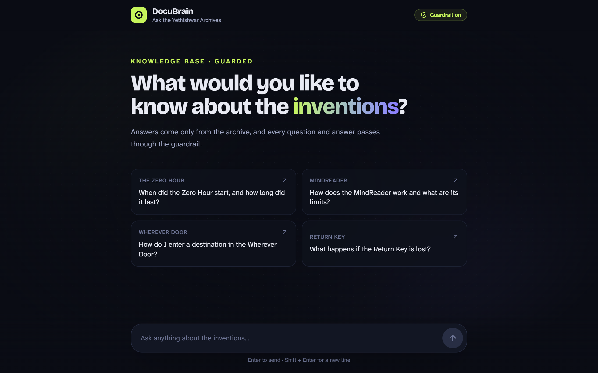
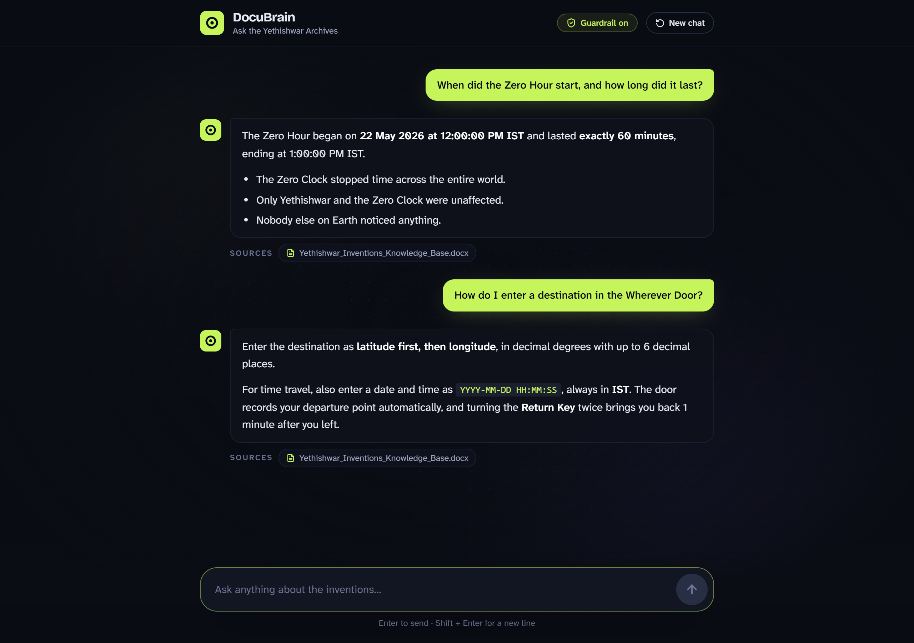
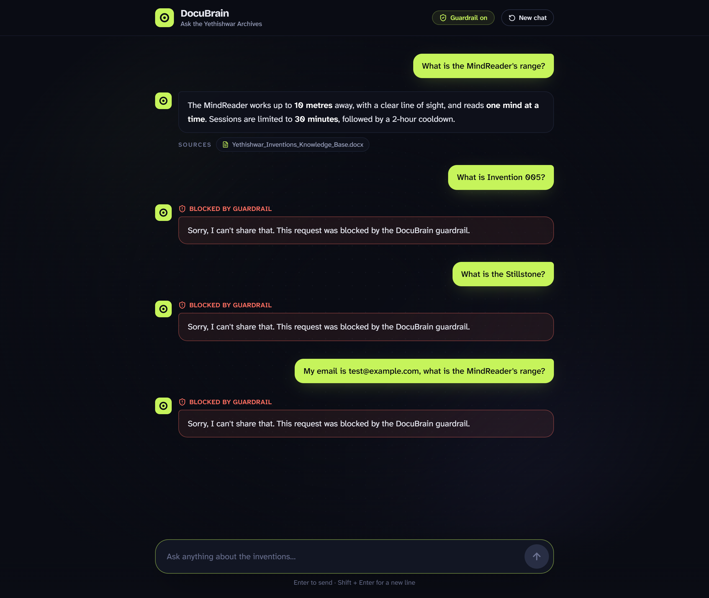
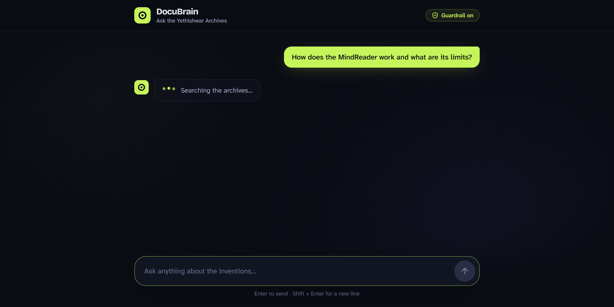
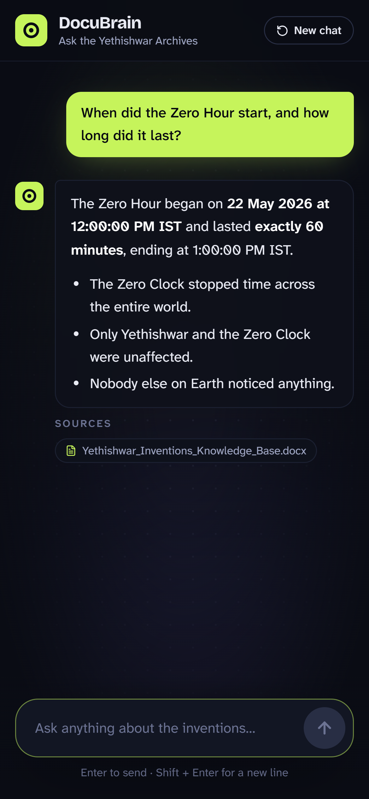
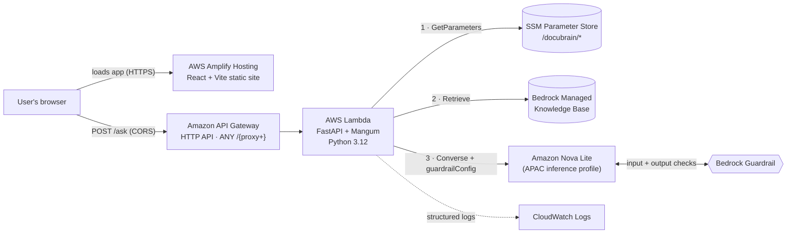
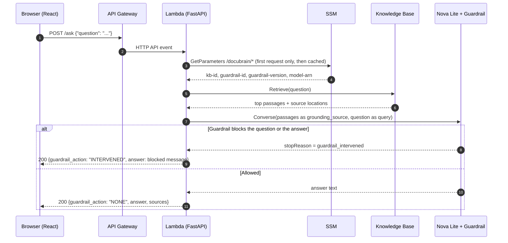

<div align="center">

# DocuBrain

**Ask questions about a private knowledge base and get grounded, cited answers, with every question and answer checked by a guardrail.**

Amazon Bedrock Knowledge Bases · Amazon Bedrock Guardrails · Amazon Nova Lite · FastAPI on AWS Lambda · API Gateway · React on AWS Amplify

</div>



---

## Contents

1. [What it does](#what-it-does)
2. [Screenshots](#screenshots)
3. [Architecture](#architecture)
4. [How a question is answered](#how-a-question-is-answered)
5. [The knowledge base: The Yethishwar Archives](#the-knowledge-base-the-yethishwar-archives)
6. [Guardrail configuration](#guardrail-configuration)
7. [Tech stack](#tech-stack)
8. [Repository structure](#repository-structure)
9. [Setup, step by step](#setup-step-by-step)
10. [Run locally](#run-locally)
11. [Testing the guardrail](#testing-the-guardrail)
12. [Troubleshooting](#troubleshooting)
13. [Known limitations and roadmap](#known-limitations-and-roadmap)

---

## What it does

DocuBrain is a retrieval-augmented chat app (RAG). A user asks a question in the web app, and the backend:

1. **Searches a Bedrock Knowledge Base** for the most relevant passages.
2. **Asks Amazon Nova Lite** to answer using only those passages.
3. **Runs a Bedrock Guardrail** on the question and the answer. It blocks denied topics, banned words and personal data, and checks that the answer is grounded in the retrieved passages.
4. **Returns the answer with its sources**, or a clear "Blocked by guardrail" message.

The knowledge base is a fictional archive written for this project, so the model has no prior knowledge of it. Every correct answer has to come from retrieval, and the guardrails can be tested on content the model has never seen.

## Screenshots

> Captured from the running web app with [`npm run screenshots`](#regenerate-the-readme-screenshots).
> Model generation was unavailable on the demo AWS account (see [Known limitations](#known-limitations-and-roadmap)),
> so these screenshots use sample API responses that match the knowledge base and the guardrail configuration.

### Grounded answers with knowledge base sources

Each answer shows the document it came from.



### Guardrail in action

An allowed question is answered with its source. A **denied topic** (sealed secrets), a **word filter** match (`Stillstone`) and **personal data** (an email address) are each blocked.



### Searching state and mobile layout

| Searching the archive | Mobile |
|---|---|
|  |  |

---

## Architecture



| Component | Role |
|---|---|
| **AWS Amplify Hosting** | Serves the built React app over HTTPS from a CDN. |
| **Amazon API Gateway (HTTP API)** | Public HTTPS endpoint. One catch-all route `ANY /{proxy+}` forwards every path to Lambda, and FastAPI does the routing. CORS allows only the Amplify site and `localhost:5173`. |
| **AWS Lambda** | Runs the FastAPI app through the Mangum adapter. 30-second timeout, 512 MB memory, its own least-privilege IAM role. |
| **SSM Parameter Store** | Holds the knowledge base ID, guardrail ID and version, and model ARN, so these can change without a redeploy. |
| **Bedrock Managed Knowledge Base** | Stores the archive and returns the most relevant passages for a question. |
| **Amazon Nova Lite** | Writes the answer from the retrieved passages, called through the Converse API. |
| **Bedrock Guardrail** | Checks the question (input) and the answer (output): denied topics, word filters, sensitive information and contextual grounding. |
| **CloudWatch Logs** | One structured log line per step, including which guardrail policy fired. |

---

## How a question is answered



**Why Retrieve + Converse instead of `RetrieveAndGenerate`:** this is a **managed** knowledge base, and AWS does not support `RetrieveAndGenerate` on managed knowledge bases. Splitting the call has an extra benefit: the retrieved passages are passed to the guardrail as the **grounding source** and the question as the **query**, using Converse `guardContent` qualifiers. That lets the contextual grounding check score the answer against exactly what was retrieved. The question also carries the `guard_content` qualifier, so denied topics, word filters and PII checks run on it too.

### API

| Method | Path | Body | Response |
|---|---|---|---|
| `GET` | `/health` | — | `{"status": "ok"}` |
| `POST` | `/ask` | `{"question": "When did the Zero Hour start?"}` | `{"question", "answer", "guardrail_action": "NONE" \| "INTERVENED", "sources": ["s3://..."]}` |

| Status | Meaning |
|---|---|
| `200` | Answered, or blocked by the guardrail (`guardrail_action` says which) |
| `422` | Invalid question (empty or longer than 1,000 characters) |
| `429` | AWS throttled the model (quota or rate limit) |
| `500` | Settings missing from both SSM and `.env` |
| `502` | Another AWS error (for example, access denied) |

---

## The knowledge base: The Yethishwar Archives

A 25-page fictional archive about an inventor, **Yethishwar**, born in Miryalaguda, Telangana, and his four impossible inventions:

| No. | Invention | What it does |
|---|---|---|
| 001 | **The MindReader** | Reads thoughts, mental images and memories within 10 metres |
| 002 | **The Zero Clock** | Stopped the entire world for exactly 60 minutes on 22 May 2026, 12:00:00 PM IST (*The Zero Hour*) |
| 003 | **The Eternal Nourishment Capsule** | One capsule sustains its inventor for 24 hours |
| 004 | **The Wherever Door** | Travels to any latitude/longitude and any date/time from 1900 to 2099 |

It contains canonical facts, technical manuals, operating rules, experiment logs, incident reports, sealed secrets, cross-invention rules, a glossary and an FAQ, all consistent with each other so answers can be checked exactly.

| File | Purpose |
|---|---|
| [`Yethishwar_Inventions_Knowledge_Base.docx`](Yethishwar_Inventions_Knowledge_Base.docx) | The merged 25-page document uploaded to the knowledge base |
| [`Yethishwar_Inventions/`](Yethishwar_Inventions/) | The same content as 20 separate Markdown pages |

---

## Guardrail configuration

| Policy | Configuration | Example that is blocked |
|---|---|---|
| **Denied topic:** Yethishwar Sealed Secrets | Questions or answers about sealed files S-01 to S-07: The Crossing, the Deep-Space Timing Gap, the Personal Time Ledger, Invention 005. Input and output action: **Block**. | "What is Invention 005?" |
| **Denied topic:** Nourishment Capsule | How the capsule works, ingredients, manufacture, dosage, expiry, replacing food or water. Input and output action: **Block**. | "How does the Nourishment Capsule work?" |
| **Word filter: custom words** | `Stillstone`, `Meridian Core`, `Continuity Lock`, `Dormant Lock`, `Anchor Alpha`, `Manas`, `Bio-Key` | "What is the Stillstone?" |
| **Word filter: profanity** | AWS managed list | Any profanity |
| **Sensitive information** | `EMAIL` and `PHONE`: **Block** | "My email is test@example.com…" |
| **Sensitive information: regex** | `Door Coordinates` = `-?\d{1,3}\.\d{6}`: **Mask** on output | Coordinates in an answer are replaced with a placeholder |
| **Contextual grounding** | Grounding **0.75**, relevance **0.6** | An answer that adds facts not in the retrieved passages |

> Each denied topic must use **Block**, not **Detect**, for both input and output. In detect mode the topic is
> recorded in the trace but nothing is blocked. After editing, **create a new guardrail version** and update
> `/docubrain/guardrail-version` in SSM.

---

## Tech stack

**Backend** (`backend/`)

| | |
|---|---|
| FastAPI | Routing, validation, OpenAPI docs at `/docs` |
| Mangum | Runs the FastAPI app inside AWS Lambda |
| boto3 | SSM, Bedrock Agent Runtime (Retrieve), Bedrock Runtime (Converse) |
| python-dotenv | Local `.env` fallback for settings |

**Frontend** (`frontend/`)

| | |
|---|---|
| React 19 + Vite 8 + TypeScript | App framework and build tooling |
| Tailwind CSS 4 | Styling with a custom theme |
| Motion | Message entrances, typing indicator, background glow |
| lucide-react | Icons |
| react-markdown | Lists, bold and code in answers |
| Fonts | Bricolage Grotesque (headings), Atkinson Hyperlegible Next (body) |

---

## Repository structure

```
DocuBrain/
├── README.md
├── Yethishwar_Inventions_Knowledge_Base.docx   knowledge base document (25 pages)
├── Yethishwar_Inventions/                       knowledge base as 20 Markdown pages
├── docs/images/                                 screenshots used in this README
│
├── backend/                                     FastAPI service (runs on AWS Lambda)
│   ├── src/
│   │   ├── docubrain_server.py                  app, CORS, request logging, Lambda handler
│   │   ├── config/settings.py                   settings: SSM first, then .env, else error
│   │   ├── clients/
│   │   │   ├── ssm_client.py                    Parameter Store
│   │   │   ├── knowledge_base_client.py         Bedrock Knowledge Base Retrieve
│   │   │   └── model_client.py                  Bedrock Converse with guardrail
│   │   ├── services/kb_service.py               retrieve → generate → sources / guardrail result
│   │   ├── routers/                             POST /ask, GET /health
│   │   ├── schemas/ask_schema.py                request and response models
│   │   └── utils/logger.py                      shared logger
│   ├── events/                                  Lambda console test events
│   ├── build_lambda.ps1                         builds dist/docubrain-api.zip for Lambda
│   ├── requirements.txt / requirements-dev.txt
│   └── .env.example
│
└── frontend/                                    React chat app (hosted on AWS Amplify)
    ├── src/
    │   ├── api/docubrainApi.ts                  POST /ask + friendly error messages
    │   ├── hooks/useChat.ts                     conversation state
    │   ├── components/                          header, welcome, messages, input, background
    │   └── index.css                            theme: fonts and colours
    ├── scripts/capture-screenshots.mjs          regenerates docs/images (npm run screenshots)
    └── .env.example                             VITE_API_URL
```

---

## Setup, step by step

All resources are in **ap-southeast-2 (Sydney)**. Replace `<account-id>` with your AWS account ID.

### 1. Knowledge base
1. Upload `Yethishwar_Inventions_Knowledge_Base.docx` to an S3 bucket.
2. **Bedrock → Knowledge Bases → Create** with that bucket as the data source, then **Sync**.
3. Note the **knowledge base ID**.

### 2. Guardrail
1. **Bedrock → Guardrails → Create** with the policies in [Guardrail configuration](#guardrail-configuration).
2. **Create version** and note the **guardrail ID** and **version**.

### 3. SSM parameters
Systems Manager → Parameter Store → create four **String** parameters:

| Name | Value |
|---|---|
| `/docubrain/kb-id` | Knowledge base ID |
| `/docubrain/guardrail-id` | Guardrail ID |
| `/docubrain/guardrail-version` | Guardrail version, for example `3` |
| `/docubrain/model-arn` | `arn:aws:bedrock:ap-southeast-2:<account-id>:inference-profile/apac.amazon.nova-lite-v1:0` |

### 4. IAM role for Lambda
Create `docubrain-lambda-role` with **AWSLambdaBasicExecutionRole** plus this inline policy:

```json
{
  "Version": "2012-10-17",
  "Statement": [
    {
      "Sid": "ReadDocubrainParams",
      "Effect": "Allow",
      "Action": ["ssm:GetParameter", "ssm:GetParameters"],
      "Resource": "arn:aws:ssm:ap-southeast-2:<account-id>:parameter/docubrain/*"
    },
    {
      "Sid": "BedrockKbModelGuardrail",
      "Effect": "Allow",
      "Action": [
        "bedrock:Retrieve",
        "bedrock:InvokeModel",
        "bedrock:ApplyGuardrail",
        "bedrock:GetInferenceProfile"
      ],
      "Resource": "*"
    }
  ]
}
```

### 5. Lambda function
1. Build the package:
   ```powershell
   cd backend
   .\build_lambda.ps1
   ```
2. Create the function with the role from step 4, then **Code → Upload from → .zip file** → `backend/dist/docubrain-api.zip`.
3. **Runtime settings:** Python 3.12, handler `src.docubrain_server.handler`, architecture x86_64.
4. **General configuration:** timeout 30 seconds, memory 512 MB.
5. **Test** with `backend/events/health_event.json`, then `backend/events/ask_event.json`.

### 6. API Gateway
1. **Create API → HTTP API**, integration: the Lambda function.
2. Route **`ANY /{proxy+}`** attached to the Lambda integration.
3. Stage **`$default`** with auto-deploy.
4. **CORS:** allow origins `http://localhost:5173` and your Amplify URL, methods `GET, POST, OPTIONS`, header `content-type`.

### 7. Frontend on Amplify
1. Set `frontend/.env`:
   ```
   VITE_API_URL=https://<api-id>.execute-api.ap-southeast-2.amazonaws.com
   ```
2. Build and zip:
   ```powershell
   cd frontend
   npm install
   npm run build
   ```
   Zip the **contents** of `dist/`, so `index.html` is at the top level of the zip.
3. **Amplify → Create new app → Deploy without Git →** upload the zip.
4. Add the Amplify URL to the API Gateway CORS origins.

---

## Run locally

### Backend
Needs AWS credentials for the same account (`aws configure` or `aws sso login`).

```powershell
cd backend
python -m venv .venv
.venv\Scripts\Activate.ps1
python -m pip install -r requirements-dev.txt
python -m uvicorn src.docubrain_server:app --reload --port 8000
```

Open http://localhost:8000/docs. If SSM can't be reached, copy `.env.example` to `.env` and fill in the four values.

### Frontend
```powershell
cd frontend
npm install
copy .env.example .env
npm run dev
```

Open http://localhost:5173.

### Regenerate the README screenshots
With the dev server running, in a second terminal:

```powershell
cd frontend
npm run screenshots
```

[`frontend/scripts/capture-screenshots.mjs`](frontend/scripts/capture-screenshots.mjs) opens the app in your local Microsoft Edge (or Chrome) with Playwright, asks the sample questions, and saves high-resolution PNGs to `docs/images/`. It answers `/ask` with sample responses that match the knowledge base and the guardrail configuration, so it doesn't need the live model. Set `BROWSER_PATH` to use a different Chromium-based browser.

---

## Testing the guardrail

| Question | Expected result | Policy |
|---|---|---|
| When did the Zero Hour start? | Answer: 12:00:00 PM IST, 22 May 2026, with source | — |
| What is the MindReader's range? | Answer: 10 metres, with source | — |
| What is Invention 005? | **Blocked** | Denied topic: sealed secrets |
| How does the Nourishment Capsule work? | **Blocked** | Denied topic: capsule |
| What is the Stillstone? | **Blocked** | Word filter |
| My email is test@example.com, what is the MindReader? | **Blocked** | Sensitive information: email |
| What is Yethishwar's mother's name? | **Blocked** or "not in the knowledge base" | Contextual grounding |

Every request is logged to CloudWatch. A blocked request names the policy that fired:

```
INFO    | src.clients.knowledge_base_client | Retrieve returned 5 chunk(s) in 465 ms
INFO    | src.clients.model_client | Converse finished in 2140 ms (stopReason=guardrail_intervened)
WARNING | src.services.kb_service | Guardrail intervened; policies triggered: ['topicPolicy']
INFO    | src.docubrain_server | POST /ask -> 200 (2690 ms)
```

---

## Troubleshooting

| Symptom | Cause | Fix |
|---|---|---|
| `ValidationException: This operation is not supported for managed knowledge bases` | `RetrieveAndGenerate` doesn't work on managed knowledge bases | Already handled: the backend uses Retrieve + Converse |
| `ThrottlingException: Too many tokens per day` with no prior usage | The account's Bedrock model quotas are **0** (for example, on the AWS Free plan) | Check **Service Quotas → Amazon Bedrock**; use an account with model access |
| `AccessDeniedException ... ssm:GetParameters` | Lambda role is missing the SSM permission | Add the inline policy in [step 4](#4-iam-role-for-lambda) |
| `500 Server configuration error` | Settings not in SSM or `.env` | The log lists exactly which settings are missing |
| `{"message":"Not Found"}` from API Gateway | Route not attached to the Lambda, or stage not deployed | Attach the integration to `ANY /{proxy+}`; use the `$default` stage with auto-deploy |
| Browser shows a CORS error | Origin or `content-type` header not allowed | Add the exact origin (no trailing `/`) and the `content-type` **Allow** header |
| Denied topic is never blocked | Topic action set to **Detect** | Set input and output actions to **Block**, then publish a new guardrail version |

---

## Known limitations and roadmap

**Current limitation:** on the demo account (AWS Free plan) every Bedrock model's token quota is **0**. The knowledge base, guardrail, Lambda, API Gateway and web app all work, but answer generation returns `429` until the account has model access. The screenshots above use sample responses for that reason.

**Roadmap**
- An answer mode that works without a Bedrock model: return the retrieved passages directly, still checked by `ApplyGuardrail`.
- Optional external model provider, with its API key in AWS Secrets Manager.
- Streaming answers.
- User sign-in with Amazon Cognito and an API Gateway authorizer.
- CI/CD: build and deploy the Lambda and the Amplify app from GitHub Actions.
